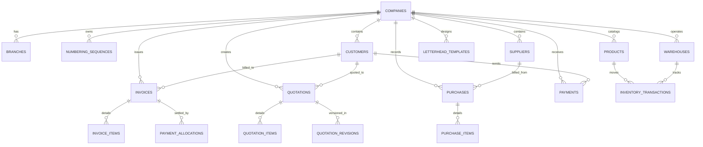

# Enterprise Invoice Manager - Technical Architecture & Developer Reference

---

## 1. System Architecture Overview

Enterprise Invoice Manager is constructed using a layered, modular architecture designed for high stability, complete offline independence, zero floating-point calculation error, and cross-platform desktop execution.

```
+--------------------------------------------------------------------------------+
|                             DESKTOP ELECTRON SHELL                             |
|  - BrowserWindow (Secure Context Isolation, nodeIntegration: false)            |
|  - Preload IPC Bridge (`window.electronAPI`)                                   |
|  - Native Menus, Window Management, Thermal/Vector Printing IPC                |
+--------------------------------------------------------------------------------+
                                       |
                                       v
+--------------------------------------------------------------------------------+
|                         FRONTEND (REACT 18 + TYPESCRIPT)                       |
|  - Modern UI Shell: Tailwind CSS, Lucide React, Component Modals, Data Tables  |
|  - Views: Company Selection, Config, Invoices, Quotes, Customers, Stock, etc.  |
|  - Typed Client API Service (`src/renderer/services/api.ts`)                  |
+--------------------------------------------------------------------------------+
                                       | HTTP / REST (Localhost)
                                       v
+--------------------------------------------------------------------------------+
|                        BACKEND API & BUSINESS SERVICES                         |
|  - Express.js Router (`/api/...`) mounted on dynamic local port (default 43210)|
|  - Controller -> Service -> Repository Architecture                            |
|  - Financial Calculation Engine (`decimal.js`)                                 |
|  - Indian GST Engine (Place of Supply, HSN Aggregation)                       |
|  - Document Numbering Sequence Generator (Atomic Transactions)                |
|  - Vector PDF & Print Overlay Engine (`pdf-lib`)                               |
|  - Offline OCR & Geometric Layout Analyzer (`tesseract.js`)                    |
|  - Import/Export Workbook Engine (`exceljs`, `csv-parse`)                      |
+--------------------------------------------------------------------------------+
                                       |
                                       v
+--------------------------------------------------------------------------------+
|                        DATABASE LAYER (KNEX.JS ABSTRACTED)                     |
|  - Knex Query Builder with Transaction & Migration Support                     |
|  - SQLite (Local Single-Computer) [WAL Mode, `min: 1, max: 1` pooling]         |
|  - PostgreSQL (Local-Network Multi-User LAN) [Connection Pooling, Row Locks]  |
|  - 27 Normalized Relational Tables with Indexes and Foreign Key Cascades      |
+--------------------------------------------------------------------------------+
```

---

## 2. Operating Modes & Database Engine

The system supports two database operation modes governed by `src/server/database/connection.ts`:

### 2.1 Mode A: Single-Computer (SQLite)
- **Engine**: SQLite3 (`sqlite3` / `better-sqlite3` compatible).
- **Location**: Local workspace or application directory (`./data/invoice_manager.sqlite3`).
- **Concurrency Management**:
  - `PRAGMA journal_mode = WAL;` (Write-Ahead Logging enables high-concurrency read operations while writes are queued).
  - `PRAGMA foreign_keys = ON;` (Enforces referential integrity at the database engine level).
  - Knex pool is configured to `{ min: 1, max: 1 }` to prevent database file locks during nested transaction reads.
- **Benefits**: Zero installation, zero administrative configuration, 100% portable.

### 2.2 Mode B: Local-Network Multi-User (PostgreSQL)
- **Engine**: PostgreSQL (`pg` driver).
- **Concurrency Management**:
  - Connection pooling with configurable pool size (min: 2, max: 10).
  - Explicit row-level locking (`FOR UPDATE`) during atomic sequence incrementation.
  - ACID compliant transactions across 3–5 simultaneous network client workstations.
- **Security**: Local network only; runs behind LAN subnet with no internet exposure.

---

## 3. Database Schema Architecture

The database schema (`src/server/database/migrations.ts`) consists of 27 relational tables designed with strict referential constraints, indexing, and foreign key cascades.

### 3.1 Schema Relationship Diagram



### 3.2 Key Table Specifications
1. **`companies`**: Primary tenant table containing legal trade names, registered addresses, GSTIN, PAN, bank accounts, and invoice terms.
2. **`branches`**: Physical facilities, branch codes, separate state jurisdictions, and dispatch locations.
3. **`numbering_sequences`**: Holds sequence prefixes, suffixes, current values, padding lengths, and fiscal year bindings.
4. **`customers` & `customer_addresses`**: Client profiles, GSTINs, state codes, opening balances, credit limits, and shipping destinations.
5. **`suppliers`**: Vendor registry, payment terms, and banking coordinates.
6. **`products` & `services`**: Master catalog with SKU, HSN/SAC codes, tax slabs, units, purchase/selling rates, and minimum stock alerts.
7. **`warehouses` & `inventory_transactions`**: Double-entry inventory movement ledger recording every inward, outward, and adjustment transaction.
8. **`invoices` & `invoice_items`**: Finalized and draft billing transactions, line taxes, discount structures, and outstanding balances.
9. **`quotations` & `quotation_items`**: Sales estimates, revision logs, and 1-click conversion state markers.
10. **`payments` & `payment_allocations`**: Receipts and disbursements with granular line-item invoice settlement records.
11. **`letterheads` & `letterhead_templates`**: OCR-derived printable coordinates and digital letterhead graphic assets.
12. **`audit_logs`**: System audit trail capturing sensitive actions (invoice cancellation, stock adjustments, database restores).

---

## 4. Financial Calculation Engine (`decimal.js`)

Floating-point representations (IEEE 754) native to JavaScript (`0.1 + 0.2 !== 0.3`) are strictly prohibited across all financial calculations.

All financial logic resides in `src/server/finance/decimalCalc.ts` utilizing `Decimal` instances with `ROUND_HALF_UP` commercial rounding:

### 4.1 Calculation Formulas

#### Exclusive Pricing (Tax Appended):
$$\text{Item Gross} = \text{Quantity} \times \text{Unit Price}$$
$$\text{Discount Amount} = \text{Item Gross} \times \frac{\text{Discount Rate}}{100}$$
$$\text{Taxable Value} = \text{Item Gross} - \text{Discount Amount}$$
$$\text{CGST} = \text{Taxable Value} \times \frac{\text{CGST Rate}}{100}$$
$$\text{SGST} = \text{Taxable Value} \times \frac{\text{SGST Rate}}{100}$$
$$\text{IGST} = \text{Taxable Value} \times \frac{\text{IGST Rate}}{100}$$
$$\text{Line Total} = \text{Taxable Value} + \text{CGST} + \text{SGST} + \text{IGST}$$

#### Inclusive Pricing (Tax Extracted from Gross):
$$\text{Item Gross} = \text{Quantity} \times \text{Unit Price}$$
$$\text{Net After Discount} = \text{Item Gross} - \text{Discount Amount}$$
$$\text{Taxable Value} = \frac{\text{Net After Discount}}{1 + \frac{\text{Tax Rate}}{100}}$$
$$\text{Total Tax} = \text{Net After Discount} - \text{Taxable Value}$$

### 4.2 Number-to-Words Converter (`numberToWords.ts`)
Converts monetary amounts into legal Indian English prose conforming to the Reserve Bank of India format:
- Grouping: Crores ($10^7$), Lakhs ($10^5$), Thousands ($10^3$), Hundreds ($10^2$).
- Example: `124500.50` $\rightarrow$ *"Rupees One Lakh Twenty-Four Thousand Five Hundred and Paise Fifty Only"*.

---

## 5. Indian GST Determination Engine

Implemented in `src/server/finance/gstEngine.ts`:

### 5.1 Place of Supply Logic
The engine evaluates the 2-digit GST state code of the issuing company branch versus the customer's Place of Supply (POS):

```typescript
if (supplierStateCode === customerPosStateCode) {
  // Intra-State: Split standard rate equally
  cgstRate = totalGstRate / 2;
  sgstRate = totalGstRate / 2;
  igstRate = 0;
} else {
  // Inter-State: Full rate allocated to Integrated GST
  cgstRate = 0;
  sgstRate = 0;
  igstRate = totalGstRate;
}
```

### 5.2 Regulatory Aggregation
- **HSN / SAC Summary Table**: Automatically aggregates total quantity, taxable turnover, CGST, SGST, and IGST by distinct HSN/SAC code as required under Rule 46 of CGST Rules for Table 12 of GSTR-1.
- **Regex Validation**:
  - GSTIN: `^[0-9]{2}[A-Z]{5}[0-9]{4}[A-Z]{1}[1-9A-Z]{1}Z[0-9A-Z]{1}$`
  - PAN: `^[A-Z]{5}[0-9]{4}[A-Z]{1}$`

---

## 6. Document Numbering & Financial Year Engine

Document sequences are handled in `src/server/services/numberingService.ts`.

### 6.1 Indian Fiscal Year Determination
The Indian Financial Year runs from April 1st through March 31st:
$$\text{Fiscal Year} = \begin{cases} (Y-1)\text{-}Y, & \text{if Month} < \text{April} \\ Y\text{-}(Y+1), & \text{if Month} \ge \text{April} \end{cases}$$
Example: For `November 2026`, Fiscal Year is `2026-27`.

### 6.2 Atomic Concurrency Control
Number allocation runs inside an isolated Knex database transaction:
1. Lock sequence record with row-level transaction (`knex('numbering_sequences').transacting(trx)`).
2. Read current counter and compute next sequence.
3. Increment database counter.
4. Format output with prefix, formatted fiscal year, and zero-padding (e.g., `VS/2026-27/0046`).
5. Commit transaction. Duplicate numbers or concurrency collisions are structurally impossible.

---

## 7. Vector PDF & Letterhead Overlay Engine

Vector PDF documents are rendered using `pdf-lib` in `src/server/services/pdfEngine.ts`:

### 7.1 Coordinate Alignment & Typography
- **StandardFonts Compatibility**: Adheres to WinAnsi encoding rules (standard `Helvetica` and `Helvetica-Bold`). Indian rupee currency notation is rendered as `Rs.` to avoid encoding faults with standard Type 1 fonts.
- **Dynamic Letterhead Overlay**:
  - In **Preprinted Mode**, the header block (company name, address, tax IDs) is completely suppressed.
  - The document table begins exactly at `template.table_top_margin_mm` (converted to PDF points: $1\text{ mm} = 2.83465\text{ pt}$).
  - Table columns automatically calculate widths and wrap multi-line item descriptions.
  - If line items exceed available page height, the engine creates new pages, repeats the header table row, and prints running page counts (`Page X of Y`).
- **In-Memory Buffer Streaming**: Rendered PDFs are streamed directly as `application/pdf` binary buffers to the Electron renderer or browser, allowing immediate print spooling or disk storage.

---

## 8. Offline OCR Layout Analyzer

Implemented in `src/server/services/letterheadService.ts`:
- Uses local `tesseract.js` worker threads.
- **Geometric Zone Detection**:
  - Analyzes bounding boxes of recognized text lines.
  - Bounding boxes located in the top 20% of the page height are tagged as the **Header Zone**.
  - Bounding boxes in the bottom 15% are tagged as the **Footer Zone**.
  - Derives safe printable margins (`top_margin_mm`, `bottom_margin_mm`).
- **Entity Extraction**:
  - Local regex scanning captures embedded GSTIN, PAN, IFSC, Phone, and Email strings from the letterhead imagery without external network requests.

---

## 9. Security & Desktop Isolation

1. **Context Isolation**: The Electron BrowserWindow enables `contextIsolation: true` and disables `nodeIntegration: false`. The renderer communicates exclusively via typed IPC channels defined in `electron/preload.ts`.
2. **Localhost Binding**: Express REST service binds strictly to `127.0.0.1` on local deployments.
3. **Data Directory Sandboxing**: All SQLite databases, snapshots, and uploaded assets reside in dedicated local directories (`./data`, `./backups`, `./uploads`), ensuring zero collision with system directories.

---

## 10. Automated Testing & Verification Suite

The codebase maintains automated verification tests in `tests/`:
1. `tests/finance.test.ts`: Validates Decimal arithmetic, line discount computations, intra-state CGST/SGST splits, and number-to-words outputs.
2. `tests/numbering.test.ts`: Validates Indian Fiscal Year transitions and zero-padded sequence formatting.
3. `tests/integration.test.ts`: End-to-end integration test creating a company, customer, product, issuing an invoice draft, finalizing the document, verifying stock deduction, and allocating customer receipt payments.

To execute the test suite:
```bash
npm run test
```

---
*Enterprise Invoice Manager - Technical Architecture & Developer Reference*
